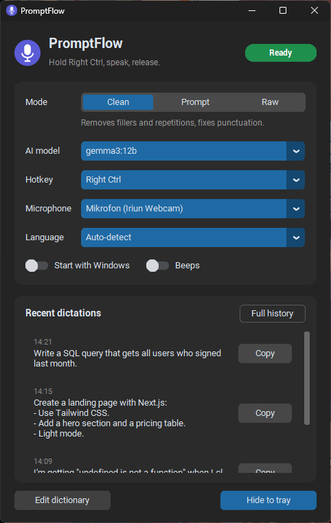

# PromptFlow

**Stop typing your prompts. Say them.** A push-to-talk dictation app for **Windows and macOS** that runs entirely
on your own machine.

Hold a key, say what you want, let go. Your speech is transcribed, cleaned of "um, uh, no wait, I meant…"
and pasted wherever your cursor is: Claude, ChatGPT, Cursor, VS Code, your browser, Discord, anything.
No audio ever leaves your computer, there's no subscription, and once it's set up it works offline.

<p align="center"></p>

> **New: PromptFlow 2.0 beta, rewritten in Rust.** No Python needed: download the installer
> (Windows `.exe`, macOS `.dmg`, under 10 MB) from [Releases](https://github.com/tugberkup/promptflow/releases),
> open it, and pick a speech model in the built-in catalog; it recommends one for your computer.
> It's faster too (about 0.4 s from releasing the key to the text on an RTX 4060 Ti) and brings over your
> 1.x history, dictionary and settings. Source and build notes are in [`rust/`](rust/).
> The instructions below are for 1.x, the Python version.

> **macOS support is in beta.** It's built and tested automatically on Apple Silicon and Intel Macs, but it has had
> less real-world use than the Windows version. Tried it on your Mac? Please fill in the short
> [macOS test report](https://github.com/tugberkup/promptflow/issues/new?template=macos-test-report.md),
> whether it worked or not.

## Features

- **Push-to-talk dictation:** hold Right Ctrl (Windows) or Right Command (macOS), speak, release;
  the text is pasted into the active window.
- **AI cleanup:** a local LLM (via Ollama) removes filler words, fixes punctuation and understands self-corrections
  ("move it to Tuesday, sorry, Wednesday" → "Wednesday"). It never answers your prompt and never translates it.
- **Prompt mode:** turns a rambling spoken request into a clear prompt.
- **Many languages:** English, Turkish and everything else Whisper supports, including mixed-language speech.
- **Personal dictionary:** fixes words that always come out wrong (`clod -> Claude`).
- **History:** every dictation is saved and can be copied again with one click.
- **Stays out of the way:** tray / menu bar icon, a small "Listening" pill at the bottom of the screen while recording,
  optional start at login.

## How it works

```
hold the hotkey ─► microphone ─► Whisper (large-v3-turbo) ─► dictionary ─► Ollama cleanup ─► Ctrl+V / Cmd+V
                                  speech to text                            (optional)
```

Whisper runs on the fastest thing your machine has: an NVIDIA GPU on Windows (faster-whisper + CUDA),
the Apple Silicon GPU on Macs (MLX), or the CPU otherwise.
Everything runs locally. Audio isn't even written to disk; only the resulting text goes to `history.txt`.

## Requirements

| | Windows | macOS |
|---|---|---|
| OS | Windows 10 / 11 | macOS 13.5 Ventura or later (Apple Silicon); macOS 12+ on Intel |
| Python | 3.11 – 3.13 (3.12 recommended) | 3.11 – 3.13 with Tk (3.12 from python.org recommended) |
| Speed | NVIDIA GPU with 8 GB+ VRAM recommended; works on the CPU (a few seconds) | Apple Silicon (M1 or later) recommended; Intel Macs use the CPU and are slower |
| AI cleanup | Optional: [Ollama](https://ollama.com) | Optional: [Ollama](https://ollama.com) |
| Disk | ~4 GB, +3–8 GB for the AI model | ~3 GB, +3–8 GB for the AI model |

## Installation on Windows

1. **Install Python 3.12** from [python.org/downloads](https://www.python.org/downloads/).
   Keep the **"py launcher"** option checked during setup.
2. **(Recommended) Install Ollama** from [ollama.com/download](https://ollama.com/download). It powers the AI cleanup;
   without it PromptFlow still works in "Raw" mode.
3. **Download PromptFlow:** click the green **Code → Download ZIP** button on this page and extract it to a folder
   (or `git clone https://github.com/tugberkup/promptflow.git`).
4. **Double-click `install.bat`.** It will:
   - install the packages into `%USERPROFILE%\.promptflow\venv` (outside synced folders like OneDrive),
   - download the speech model (~1.6 GB, once),
   - if Ollama is installed, ask which AI model to download,
   - put a **PromptFlow** shortcut in the folder and start the app.

After the first launch PromptFlow is also in the Start menu; just search for "PromptFlow".

> Windows SmartScreen or your antivirus may warn about an app that listens to a keyboard shortcut. The code is open:
> `HotkeyListener` in `platform_win.py` shows what it listens to (only the hotkey you picked).

## Installation on macOS (beta)

1. **Install Python 3.12** from [python.org/downloads/macos](https://www.python.org/downloads/macos/)
   (it includes Tk, which the window needs). With Homebrew: `brew install python@3.12 python-tk@3.12`.
2. **(Recommended) Install Ollama** from [ollama.com/download](https://ollama.com/download) or `brew install ollama`.
3. **Download PromptFlow into your home folder** (not Desktop, Documents or Downloads, which macOS guards with
   extra permission prompts). In Terminal:
   ```bash
   git clone https://github.com/tugberkup/promptflow.git ~/promptflow
   ```
   (or download the ZIP and move the extracted folder to your home folder).
4. **Run the installer** in Terminal:
   ```bash
   bash ~/promptflow/install.command
   ```
   It installs the packages into `~/.promptflow/venv`, downloads the speech model (~1.6 GB, once), offers an AI model
   if Ollama is installed, creates **PromptFlow** in `~/Applications` and starts it.
5. **Allow the three permissions** macOS asks for. PromptFlow shows a reminder in its window until they're all on:

   | Permission | Why | Where |
   |---|---|---|
   | **Microphone** | Recording while you hold the hotkey | asked on first start |
   | **Input Monitoring** | Noticing the hotkey while you're in other apps | System Settings → Privacy & Security → Input Monitoring |
   | **Accessibility** | Pressing Cmd+V for you | System Settings → Privacy & Security → Accessibility |

   Turn **PromptFlow** on in each list. If the hotkey still does nothing after allowing Input Monitoring,
   quit PromptFlow from the menu bar and open it again.

After that, open PromptFlow from Spotlight or Launchpad like any other app.

## Usage

1. Wait for the microphone icon next to the clock (Windows) or in the menu bar (macOS).
   The first start takes a few seconds.
2. Click into the text box you want to write in.
3. **Hold the hotkey → speak → release.** Right Ctrl on Windows, Right Command on macOS.

While recording, a **"● Listening"** pill shows up at the bottom of the screen and the icon turns red.
On release it shows "Transcribing", then "✓ Pasted". If you use the hotkey together with another key
(e.g. Ctrl+C or Cmd+C), the dictation is cancelled and the normal shortcut works as usual.

Closing the window doesn't quit the app; it keeps running in the tray / menu bar. Use the icon's menu for
**Show / Pause / Quit**.

### Modes

| Mode | What it does | Example |
|---|---|---|
| **Clean** | Removes fillers, repetitions and self-corrections | "make the button red no wait make it blue" → "Make the button blue." |
| **Prompt** | Rewrites what you said as a clear prompt | "I want a landing page with next js uh tailwind and a pricing table" → a bulleted request |
| **Raw** | No AI; exactly what Whisper heard | Fastest, doesn't need Ollama |

### The window

| Setting | |
|---|---|
| **AI model** | Pick one of the models installed in Ollama (see the table below) |
| **Hotkey** | Windows: Right Ctrl, Right Shift, F8, F9, F10, Scroll Lock, Pause (no Right Alt: it's AltGr on many layouts). macOS: Right Command, Right Option, Right Control, Right Shift, Fn (Globe), F8–F10, F13 |
| **Microphone** | A specific microphone instead of the system default |
| **Language** | Auto-detect, or pin a language if short sentences get detected wrong |
| **Start with Windows / Start at login** | Starts quietly in the tray / menu bar when you log in |
| **Recent dictations** | Copy a dictation again if the paste went to the wrong place |
| **Edit dictionary** | `dictionary.txt`: one `wrong -> right` per line, applied as soon as you save |

Your choices are saved to `settings.json`.

## Which AI model?

The cleanup model shares the GPU (or a Mac's memory) with Whisper, which uses ~2–3 GB.

| Windows GPU | Mac memory | Model | Install | Speed (per sentence) |
|---|---|---|---|---|
| 16 GB+ VRAM | 24 GB+ | `gemma3:12b` (default) | `ollama pull gemma3:12b` | ~1–1.5 s, handles self-corrections well |
| 8–12 GB VRAM | 16 GB | `gemma3:4b` | `ollama pull gemma3:4b` | faster, sometimes misses corrections |
| No / small GPU | 8 GB | — | | **Raw** mode |

After downloading a model, select it in the **AI model** menu. Windows timings measured on an RTX 4060 Ti 16 GB.

## Advanced settings

At the top of `promptflow.py`:

| Setting | Default | |
|---|---|---|
| `MODEL` | `large-v3-turbo` | Whisper model. Use `small` or `base` on weak machines. |
| `INITIAL_PROMPT` | Claude, React, Next.js… | Terms you use often, given to Whisper as a hint |
| `DEVICE` | `auto` | `cuda` (NVIDIA), `mlx` (Apple Silicon) or `cpu` |
| `MIN_SECONDS` | `0.4` | Shorter presses are ignored |
| `RESTORE_CLIPBOARD` | `True` | Puts your previous clipboard back after pasting |
| `WAKE_ENABLED` | `False` | **Experimental:** say "Promptflow" to dictate without a hotkey. Keeps the microphone open. |

To run it in a console (for debugging):
- Windows: `%USERPROFILE%\.promptflow\venv\Scripts\python promptflow.py`
- macOS: `~/.promptflow/venv/bin/python promptflow.py` (the permissions then apply to Terminal)

## Troubleshooting

| Problem | Fix |
|---|---|
| Nothing was pasted | Copy it from **Recent dictations**. Windows: if the target window runs as administrator, run PromptFlow as administrator too. macOS: check **Accessibility**. |
| The hotkey does nothing (macOS) | Allow **Input Monitoring**, then quit and reopen PromptFlow. |
| "The microphone only sent silence" | Pick the right microphone. Windows: Settings → Privacy → Microphone → "Let desktop apps access your microphone". macOS: System Settings → Privacy & Security → Microphone → PromptFlow. |
| Fn (Globe) opens the emoji picker (macOS) | System Settings → Keyboard → "Press 🌐 key to" → **Do Nothing**, or pick another hotkey. |
| F8–F10 control music instead (macOS) | Hold Fn with them, or turn on "Use F1, F2, etc. keys as standard function keys" in Keyboard settings. |
| No AI cleanup | Is Ollama running and is the selected model installed? (`ollama list`) |
| Too slow | Windows: check the GPU with `nvidia-smi`. Both: pick a smaller AI model or switch to **Raw** mode. |
| `PortAudio library not found` / `error 0xce` (Windows) | The folder path exceeds Windows' 260-character limit; move the project to a shorter path. |
| Anything else | Check `promptflow.log` in the folder and [open an issue](https://github.com/tugberkup/promptflow/issues). |

## Uninstall

**Windows**
1. Turn off **Start with Windows** in the window, then **Quit** from the tray.
2. Delete the project folder and `%USERPROFILE%\.promptflow`.
3. Start menu shortcut: `%APPDATA%\Microsoft\Windows\Start Menu\Programs\PromptFlow.lnk`
4. Speech model: `%USERPROFILE%\.cache\huggingface\hub\models--mobiuslabsgmbh--faster-whisper-large-v3-turbo`
5. AI model: `ollama rm gemma3:12b`

**macOS**
1. Turn off **Start at login** in the window, then **Quit** from the menu bar.
2. Delete the project folder, `~/.promptflow` and `~/Applications/PromptFlow.app`.
3. Speech model: `~/.cache/huggingface/hub/models--mlx-community--whisper-large-v3-turbo`
4. AI model: `ollama rm gemma3:12b`
5. Optionally remove PromptFlow from the Privacy & Security lists.

## Project structure

```
app.pyw            desktop app: window, tray / menu bar icon, recording pill
promptflow.py      engine: recording, Whisper, dictionary, Ollama, pasting (also runs in a console)
platform_win.py    everything Windows-specific (hotkey, Ctrl+V, tray, autostart, CUDA)
platform_mac.py    the same for macOS (event tap, Cmd+V, menu bar, LaunchAgent, permissions)
install.bat        Windows setup          start.bat       starts it without a console
install.command    macOS setup            start.command   starts it on macOS
requirements.txt   Python packages for both systems
tests/             unit tests, run on Windows and macOS by GitHub Actions
assets/            icon
```

`history.txt`, `dictionary.txt`, `settings.json` and `promptflow.log` are created on your machine and are not tracked by git.

## License

[MIT](LICENSE). Use it, change it, share it.
