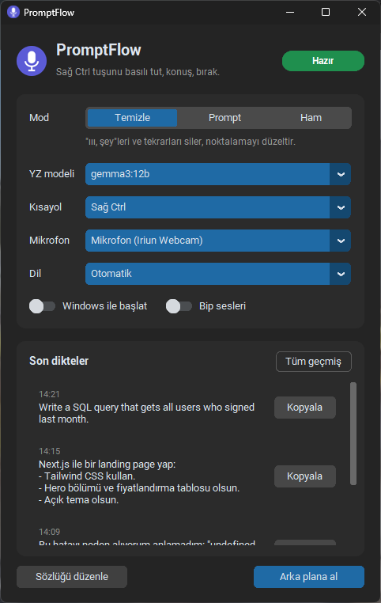

# PromptFlow

**Prompt'larını yazma, anlat.** Windows için tamamen bilgisayarında çalışan bir bas-konuş dikte uygulaması.

Bir tuşu basılı tut, ne istediğini anlat, bırak. Söylediklerin yazıya çevrilir, "ııı, şey, yok yok şöyle"lerden temizlenir
ve imlecin olduğu yere yapıştırılır: Claude, ChatGPT, Cursor, VS Code, tarayıcı, Discord… hangisi olursa.
Ses hiçbir sunucuya gitmez, abonelik yok; kurulumdan sonra internet de gerekmez.

<p align="center"></p>

> 🇬🇧 English summary at the [bottom](#english).

## Neler yapıyor

- **Bas-konuş dikte:** Sağ Ctrl'yi basılı tut, konuş, bırak; yazı aktif pencereye yapıştırılır.
- **Yapay zeka ile toparlama:** Yerel bir dil modeli (Ollama) dolgu sözcüklerini siler, noktalamayı düzeltir,
  kendini düzeltmeleri anlar ("salıya alalım, pardon çarşamba" → "Çarşamba"). Soruları cevaplamaz, dili değiştirmez.
- **Prompt modu:** Dağınık anlattığın isteği madde madde, düzgün bir prompt'a çevirir.
- **Türkçe ve İngilizce** (ve Whisper'ın desteklediği diğer diller), karışık kullanım dahil.
- **Kişisel sözlük:** Hep yanlış yazılan kelimeleri düzeltir (`klod -> Claude`).
- **Geçmiş:** Her dikte saklanır, pencereden tek tıkla kopyalanır.
- **Arka planda çalışır:** Tepsi ikonu, kayıt sırasında ekranın altında küçük bir "Dinliyorum" balonu,
  isteğe bağlı olarak Windows ile birlikte başlama.

## Nasıl çalışıyor

```
Sağ Ctrl basılı ─► mikrofon ─► faster-whisper (large-v3-turbo, GPU) ─► sözlük ─► Ollama ile toparlama ─► Ctrl+V
                                        yazıya çevirme                                (isteğe bağlı)
```

Her şey senin bilgisayarında olur. Ses diske de kaydedilmez; sadece ortaya çıkan metin `gecmis.txt`'ye yazılır.

## Gereksinimler

| | Gerekli | Önerilen |
|---|---|---|
| İşletim sistemi | Windows 10 / 11 | |
| Python | 3.11 – 3.13 | 3.12 |
| Ekran kartı | Yok da olur (işlemciyle çalışır, birkaç saniye sürer) | NVIDIA, 8 GB+ VRAM |
| Yapay zeka ile toparlama | İsteğe bağlı | [Ollama](https://ollama.com) |
| Disk | ~4 GB | +3–8 GB yapay zeka modeli için |

## Kurulum

1. **Python 3.12'yi kur:** [python.org/downloads](https://www.python.org/downloads/).
   Kurulumda **"py launcher"** seçeneği işaretli kalsın.
2. **(Önerilen) Ollama'yı kur:** [ollama.com/download](https://ollama.com/download). Yapay zeka ile toparlama için gerekli;
   kurmazsan PromptFlow "Ham" modda yine çalışır.
3. **PromptFlow'u indir:** Bu sayfada yeşil **Code → Download ZIP**'e tıkla ve bir klasöre çıkar
   (ya da `git clone https://github.com/tugberkup/promptflow.git`).
4. **`kur.bat`'a çift tıkla.** Şunları yapar:
   - Paketleri `%USERPROFILE%\.promptflow\venv` içine kurar (OneDrive gibi senkron klasörlere dokunmaz),
   - Konuşma modelini indirir (~1,6 GB, bir kere),
   - Ollama kuruluysa hangi yapay zeka modelini indirmek istediğini sorar,
   - Klasöre bir **PromptFlow** kısayolu koyar ve uygulamayı açar.

İlk açılıştan sonra PromptFlow Başlat menüsünde de görünür; Windows aramasında "PromptFlow" yazman yeter.

> Windows SmartScreen ya da antivirüs, klavye kısayolunu dinlediği için uyarı verebilir. Kod açık;
> neyi dinlediğini `promptflow.py` içindeki `Engine._on_press` fonksiyonunda görebilirsin (sadece seçtiğin kısayol tuşu).

## Kullanım

1. Saatin yanında mor mikrofon ikonu belirince hazırdır (ilk açılış birkaç saniye sürer).
2. Yazının gideceği kutuya tıkla.
3. **Sağ Ctrl**'yi basılı tut → anlat → bırak.

Kayıtta ekranın altında **"● Dinliyorum"** balonu çıkar, tepsi ikonu kırmızı olur. Bırakınca "Yazıya çevriliyor",
sonra "✓ Yapıştırıldı". Kısayol tuşunu başka bir tuşla birlikte kullanırsan (ör. Ctrl+C) dikte iptal olur ve normal kısayol çalışır.

Pencereyi kapatınca uygulama kapanmaz, tepsiye iner. Tepsi ikonuna sağ tıkla: **Göster / Duraklat / Çıkış**.

### Modlar

| Mod | Ne yapar | Örnek |
|---|---|---|
| **Temizle** | Dolgu sözcüklerini, tekrarları ve kendini düzeltmeleri temizler | "ııı şu butonu kırmızı yap yok yok mavi yap" → "Şu butonu mavi yap." |
| **Prompt** | Anlattığını yapılandırılmış bir prompt'a çevirir | "next js ile landing page istiyorum ııı tailwind olsun bir de fiyat tablosu" → maddeli istek |
| **Ham** | Yapay zeka yok; Whisper ne duyduysa o | En hızlısı, Ollama gerekmez |

### Pencerede neler var

| Ayar | |
|---|---|
| **YZ modeli** | Ollama'da kurulu modellerden seç (aşağıdaki tabloya bak) |
| **Kısayol** | Sağ Ctrl, Sağ Shift, F8, F9, F10, Scroll Lock, Pause. Sağ Alt yok, çünkü Türkçe klavyede AltGr'dir. |
| **Mikrofon** | Windows'un varsayılanı yerine belirli bir mikrofon |
| **Dil** | Otomatik / Türkçe / English. Kısa cümlelerde dil yanlış algılanıyorsa sabitle. |
| **Windows ile başlat** | Bilgisayar açılınca sessizce tepside başlar |
| **Son dikteler** | Yapıştırma bir yere gitmediyse buradan kopyala |
| **Sözlüğü düzenle** | `sozluk.txt`: her satıra `yanlış -> doğru`. Kaydettiğin an geçerli olur. |

Seçimler `ayarlar.json`'a kaydedilir.

## Hangi yapay zeka modeli?

Toparlama modeli Whisper ile aynı ekran kartını paylaşır (Whisper ~2–3 GB kullanır).

| Ekran kartı | Model | Kurulum | Hız (cümle başına) |
|---|---|---|---|
| 16 GB+ VRAM | `gemma3:12b` (varsayılan) | `ollama pull gemma3:12b` | ~1–1,5 sn, kendini düzeltmeleri iyi anlar |
| 8–12 GB VRAM | `gemma3:4b` | `ollama pull gemma3:4b` | daha hızlı, düzeltmeleri bazen kaçırır |
| GPU yok / az | — | | **Ham** mod |

Model indirdikten sonra pencereden **YZ modeli** menüsünden seç. Hız ölçümleri RTX 4060 Ti 16 GB üzerinde yapıldı.

## Gelişmiş ayarlar

`promptflow.py`'nin en üstünde:

| Ayar | Varsayılan | |
|---|---|---|
| `MODEL` | `large-v3-turbo` | Whisper modeli. Zayıf makinede `small` ya da `base`. |
| `INITIAL_PROMPT` | Claude, React, Next.js… | Whisper'a sık kullandığın terimleri ipucu olarak ver |
| `DEVICE` | `auto` | `cuda` / `cpu` |
| `MIN_SECONDS` | `0.4` | Bundan kısa basışlar yok sayılır |
| `RESTORE_CLIPBOARD` | `True` | Yapıştırdıktan sonra panodaki eski metni geri koyar |
| `WAKE_ENABLED` | `False` | **Deneysel:** "Promptflow" deyince kısayolsuz dikte. Açıkken mikrofon sürekli dinler. |

Konsolda çalıştırmak (hata ayıklamak için): `%USERPROFILE%\.promptflow\venv\Scripts\python promptflow.py`

## Sorun giderme

| Sorun | Çözüm |
|---|---|
| Yazı yapıştırılmadı | Pencerede **Son dikteler**'den kopyala. Hedef pencere yönetici olarak açıksa PromptFlow'u da yönetici olarak çalıştır. |
| Hiç ses algılanmıyor | Pencereden doğru mikrofonu seç. Windows Ayarlar → Gizlilik → Mikrofon → "Masaüstü uygulamalarının erişimine izin ver" açık olmalı. |
| Toparlama yapılmıyor | Ollama açık mı ve seçili model kurulu mu? (`ollama list`) |
| Çok yavaş | `nvidia-smi` ile GPU'yu kontrol et; daha küçük bir yapay zeka modeli seç ya da **Ham** moda geç. |
| `PortAudio library not found` / `error 0xce` | Klasör yolu Windows'un 260 karakter sınırını aşıyor; projeyi daha kısa bir yola taşı. |
| Başka bir sorun | Klasördeki `promptflow.log` dosyasına bak, [issue aç](https://github.com/tugberkup/promptflow/issues). |

## Kaldırma

1. Pencereden **Windows ile başlat**'ı kapat, sonra tepsiden **Çıkış**.
2. Proje klasörünü ve `%USERPROFILE%\.promptflow` klasörünü sil.
3. Başlat menüsü kısayolu: `%APPDATA%\Microsoft\Windows\Start Menu\Programs\PromptFlow.lnk`
4. Konuşma modeli: `%USERPROFILE%\.cache\huggingface\hub\models--mobiuslabsgmbh--faster-whisper-large-v3-turbo`
5. Yapay zeka modeli: `ollama rm gemma3:12b`

## Proje yapısı

```
app.pyw           arayüz: pencere, tepsi ikonu, kayıt balonu
promptflow.py     motor: kayıt, Whisper, sözlük, Ollama, yapıştırma (konsolda da çalışır)
kur.bat           tek tıkla kurulum
baslat.bat        konsolsuz başlatma (kurulum yoksa önce kurar)
requirements.txt  Python paketleri
assets/           ikon
```

Kendi bilgisayarında oluşan `gecmis.txt`, `sozluk.txt`, `ayarlar.json` ve `promptflow.log` dosyaları git'e girmez.

## English

**PromptFlow** is a fully local, push-to-talk dictation app for Windows, built for dictating prompts instead of typing them.
Hold **Right Ctrl**, speak, release: your speech is transcribed with [faster-whisper](https://github.com/SYSTRAN/faster-whisper)
on your GPU, optionally cleaned up by a local LLM via [Ollama](https://ollama.com) (filler words, self-corrections,
punctuation; or restructured into a proper prompt), and pasted wherever your cursor is. Nothing leaves your machine.

**Install:** Python 3.12 (with the py launcher) → optionally Ollama → download this repo → double-click `kur.bat`.
The UI is in Turkish; transcription works in English, Turkish and any language Whisper supports
(set *Dil* to *English* to pin it). Model guidance: `gemma3:12b` for 16 GB VRAM, `gemma3:4b` for 8 GB, or the *Ham* (raw) mode without an LLM.

## Lisans

[MIT](LICENSE). İstediğin gibi kullan, değiştir, paylaş.
